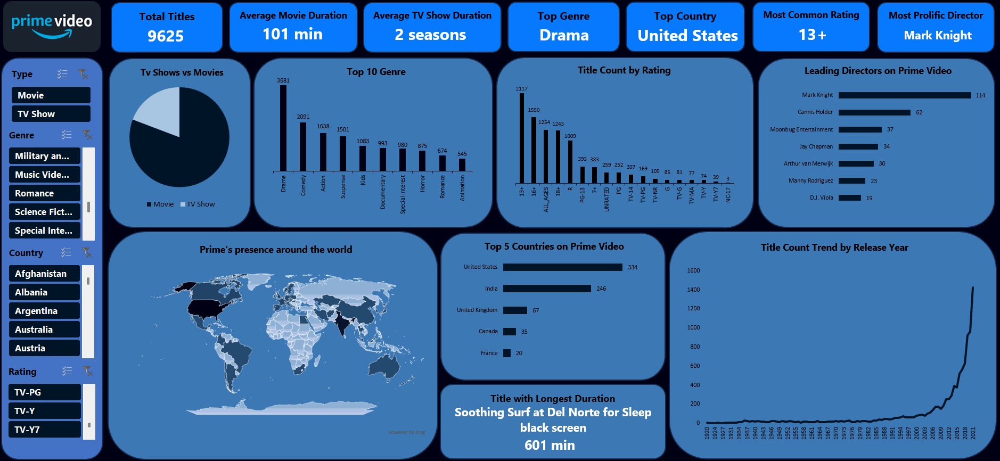

# Amazon Prime Video Content Analysis Dashboard

## Project Overview
An interactive Excel dashboard developed to analyze Amazon Prime Video content and explore trends in content distribution across genres, ratings, countries, and release years.

## Tools & Technologies
- Microsoft Excel
- Power Query
- Pivot Tables
- Pivot Charts

## Key Features
- Analysis of content distribution across genres and ratings.
- Country-wise content analysis.
- Release-year trends and content distribution.
- Interactive slicers for dynamic filtering.
- KPI cards and visualizations for key metrics.

## Data Preparation
Used Power Query for data cleaning and transformation to prepare the dataset for analysis.

## Dashboard Preview

## Project File
- [Download Excel Dashboard](amazon_prime_analysis.xlsx)
